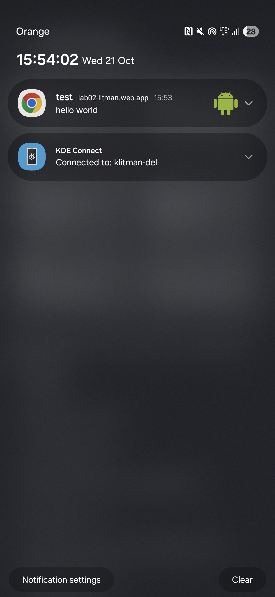

# Lab 02 - Powiadomienia i Web Push

## Co zostało zrealizowane
W trakcie laboratorium wykonano aplikację PWA z powiadomieniami na podstawie otrzymanych materiałów.

Aplikacja spełnia wszystkie wymagania, tj.:
- o zgodę na powiadomienia aplikacja pyta dopiero po kliknięciu przycisku, a aktualny stan uprawnienia (`default` / `granted` / `denied`) jest widoczny na stronie
- formularz z polami tytuł, treść i ikona (lista `select` z czterema obrazkami) wyświetla powiadomienie przez service workera, dzięki czemu działa także na Androidzie
- puste pole tytułu nie wyświetla powiadomienia
- kliknięcie w powiadomienie przywołuje otwarte okno aplikacji, a gdy go nie ma - otwiera nowe
- obsługa Web Push: subskrypcja, anulowanie subskrypcji i wyświetlenie powiadomienia wysłanego skryptem `send-push.mjs`, także przy zamkniętej karcie z aplikacją
- wdrożono aplikację na Firebase (HTTPS), a powiadomienie push dociera na telefon
- klucz prywatny VAPID (`vapid-keys.json`) oraz `subscription.json` są w `.gitignore` i nie znajdują się w repozytorium

## Uruchomienie
Aplikacja wdrożona na Firebase pod linkiem https://lab02-litman.web.app/

Lokalnie aplikację można uruchomić poprzez
```bash
cd public
npx serve
```

Wysyłanie powiadomienia push (po wygenerowaniu kluczy i zapisaniu subskrypcji w `subscription.json`):
```bash
npm install
node generate-keys.mjs
node send-push.mjs "test" "hello world"
```

## Screenshot

