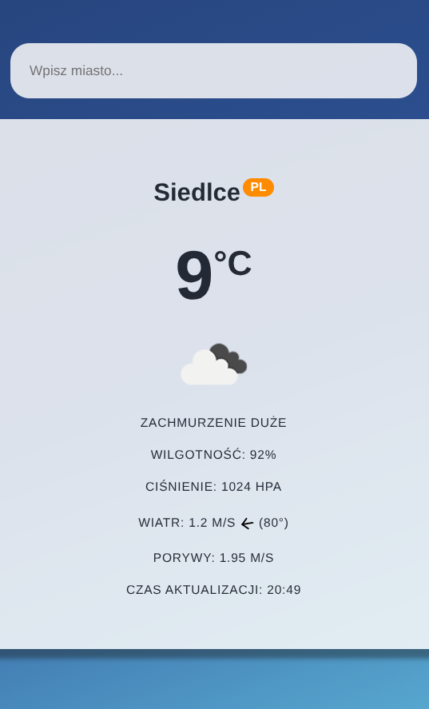
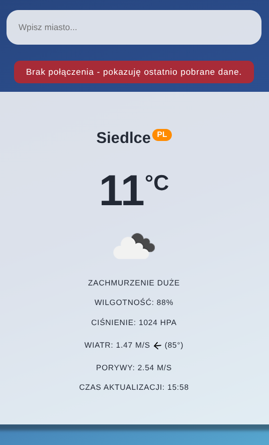
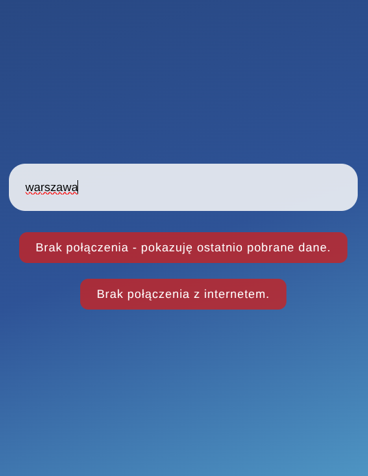

# Lab 03 - Weather App (komunikacja sieciowa w PWA)

## Co zostało zrealizowane

W trakcie laboratorium wykonano w React (Vite) aplikację pogodową pobierającą dane z OpenWeatherMap (Current Weather Data) i zamieniono ją w PWA działającą bez sieci.

Aplikacja spełnia wszystkie wymagania, tj.:

- zapytania do API realizuje `fetch()` w pliku `src/api/fetchWeather.js`, z obsługą błędów: nieznane miasto (404), nieprawidłowy klucz (401), błąd serwera i brak sieci
- stan komponentu (`useState`): zapytanie, pobrana pogoda, błąd i trwające pobieranie
- karta miasta z nazwą i kodem kraju, temperaturą (zaokrągloną), ikoną i opisem pogody
- dodatkowo: ciśnienie (hPa), wilgotność (%), prędkość wiatru (m/s), porywy (tylko gdy `wind.gust` istnieje) oraz kierunek wiatru w stopniach wraz ze strzałką obracaną o `wind.deg`
- godzina pomiaru wyliczona z pola `dt`
- stan `online` (początkowo `navigator.onLine`, aktualizowany zdarzeniami `online` / `offline` w `useEffect`) - po utracie połączenia nad kartą wyświetla się komunikat „Brak połączenia - pokazuję ostatnio pobrane dane."
- PWA (`vite-plugin-pwa`): manifest, ikony, precache plików aplikacji oraz service worker z regułami `runtimeCaching`:
  - `NetworkFirst` dla odpowiedzi API - bez sieci zwracana jest ostatnia zapisana odpowiedź dla tego samego adresu (nazwa miasta jest zamieniana na małe litery)
  - `CacheFirst` dla ikon pogody
- aplikacja działa w trybie offline: dla wcześniej wyszukanego miasta pokazuje ostatnio pobrane dane, a dla nowego - komunikat `Brak połączenia z internetem.`

Zakres zadania dla chętnych (strona świata zamiast stopni, `id` i `screenshots` w manifeście) nie został wykonany.
Wykonano natomiast odpowiednio skierowaną strzałkę reprezentującą kierunek wiatru.

## Uruchomienie

Service worker działa tylko w wersji produkcyjnej, dlatego aplikację należy zbudować i uruchomić w trybie podglądu:

```bash
npm install
npm run build
npm run preview
```

Aplikacja jest dostępna pod adresem http://localhost:4173/. Tryb deweloperski (bez service workera): `npm run dev`.

## Screenshoty

Pogoda dla wybranego miasta:



Tryb offline - ostatnio pobrane dane dla wcześniej wyszukanego miasta:



Tryb offline - miasto, którego wcześniej nie wyszukiwano:


