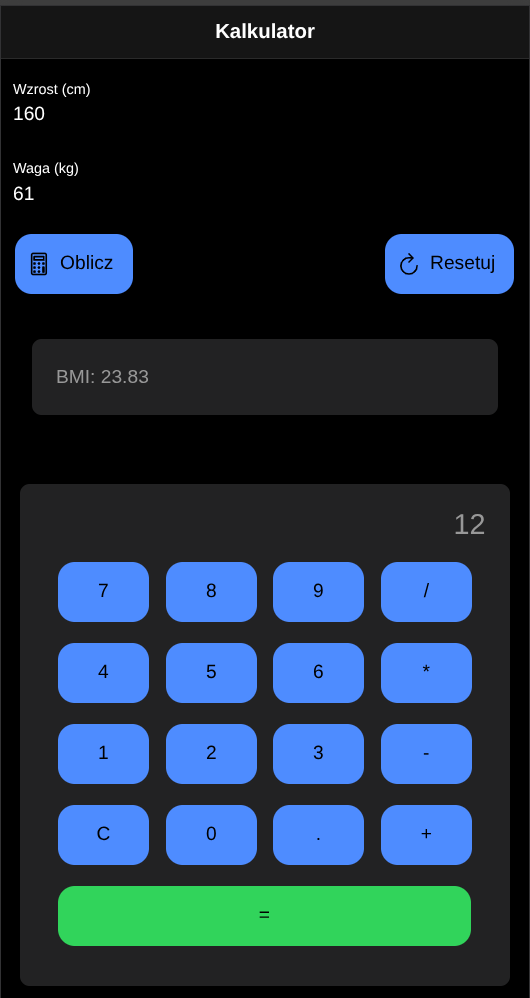

# Lab 04 - Pierwsza aplikacja w Ionic React

## Co zostało zrealizowane

W trakcie laboratorium utworzono projekt Ionic React (szablon `blank`), usunięto z niego routing i stronę `Home`, a następnie zbudowano w nim kalkulator BMI oraz prosty kalkulator czterodziałaniowy jako osobny komponent.

Aplikacja spełnia wszystkie wymagania, tj.:

- **kalkulator BMI** (`src/App.tsx`):
  - nagłówek z tytułem oraz siatka `IonGrid` z polami `IonInput` na wzrost (cm) i wagę (kg)
  - wartości pól odczytywane przez `useRef`, BMI liczone ze wzrostu przeliczonego na metry
  - przyciski „Oblicz” i „Resetuj” z ikonami z `ionicons/icons`, umieszczone przy przeciwnych krawędziach ekranu
  - wynik przechowywany w stanie (`useState`) i wyświetlany w karcie `IonCard` z dokładnością do dwóch miejsc po przecinku, tylko gdy BMI zostało obliczone
  - „Resetuj” czyści pola i ukrywa kartę z wynikiem
- **kalkulator** (`src/components/Kalkulator.tsx`), osadzony w `App.tsx` pod kalkulatorem BMI:
  - wyświetlacz (`<h1>`) z wartością trzymaną w stanie
  - przyciski cyfr, działań (`+`, `-`, `*`, `/`), kropki, `C` i `=` ułożone w siatce `IonGrid` w czterech kolumnach
  - działanie liczone instrukcją `switch`, bez `eval()` i `new Function()`; wynik zaokrąglany przez `parseFloat(wynik.toFixed(10))`, więc `0.1 + 0.2` daje `0.3`
  - wynik można wykorzystać w kolejnym działaniu (`9 - 4 =`, potem `* 3 =` daje 15)
  - druga kropka w jednej liczbie jest ignorowana, a wiodące zero jest zastępowane wpisaną cyfrą
  - `C` czyści wszystko
  - dzielenie przez zero wyświetla napis „Nie można dzielić przez zero”, a kolejna wpisana cyfra rozpoczyna nowe obliczenie

Z zakresu dla chętnych wykonano liczenie łańcuchowe jak w kalkulatorze Windows - `2 + 3 +` od razu pokazuje 5. Tak jak w Windowsie, `=` kliknięte bezpośrednio po działaniu używa liczby z wyświetlacza jako drugiego argumentu (`2 + 2 + =` daje 8).

Nie wykonano:

- przycisków `+-`, `%` i `<x]` (usuwanie ostatniej cyfry)
- obsługi klawiatury

## Uruchomienie

```bash
npm install
ionic serve
```

Gdy Ionic CLI nie jest zainstalowane globalnie, zamiast `ionic serve` można użyć `npx @ionic/cli serve`.

Aplikacja jest dostępna pod adresem http://localhost:8100/.

## Screenshot

Widok całej aplikacji


