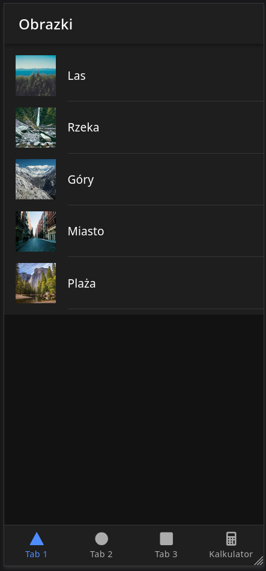
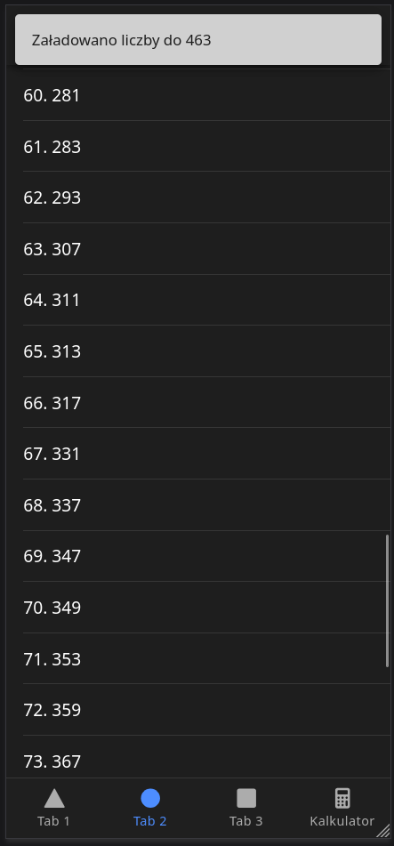
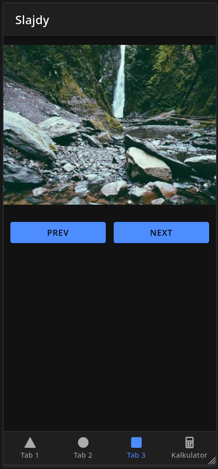
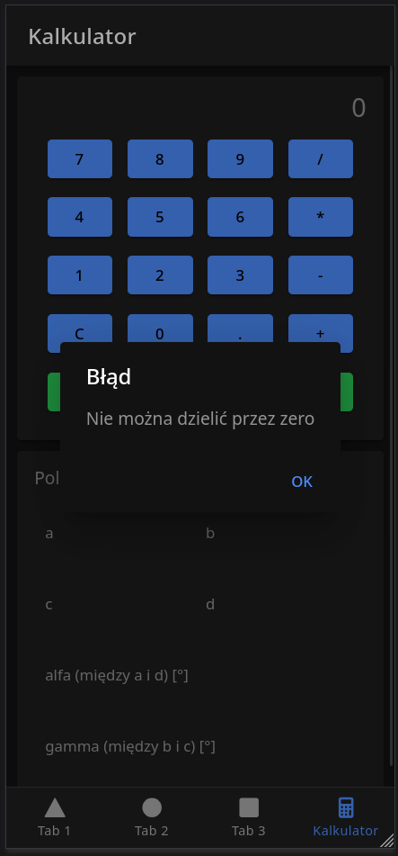
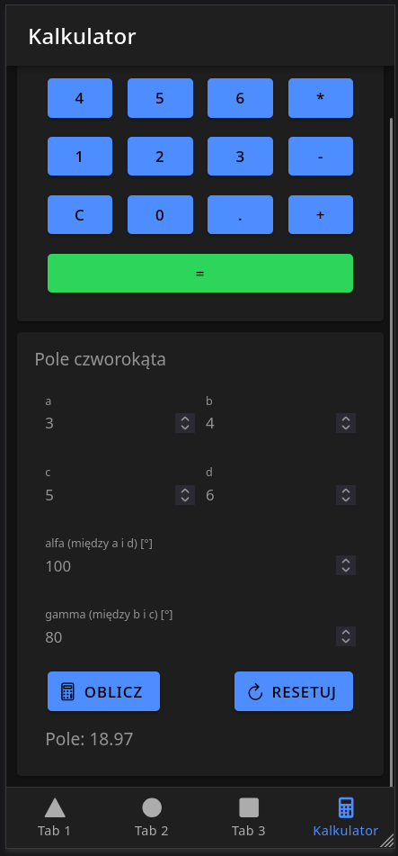

# Lab 05 - Podstawowe komponenty Ionic React

## Co zostało zrealizowane

W trakcie laboratorium utworzono projekt Ionic React z szablonu `tabs` i na każdej zakładce wypróbowano inne komponenty Ionic.

Aplikacja spełnia wszystkie wymagania, tj.:

- **nawigacja zakładkami** (`src/App.tsx`):
  - dodana czwarta zakładka „Kalkulator” (`src/pages/Tab4.tsx`) z trasą `/tab4` w `IonRouterOutlet` i przyciskiem `IonTabButton` z ikoną `calculator`
- **lista obrazków** (`src/pages/Tab1.tsx`):
  - lista `IonList` budowana metodą `map` z tablicy danych typu `Item[]` (adres obrazka i podpis)
  - każdy element to `IonItem` z miniaturą `IonThumbnail` (`slot="start"`), obrazkiem `` i podpisem `IonLabel`
  - obrazki pobierane z serwisu picsum.photos
- **liczby pierwsze z infinite scroll** (`src/pages/Tab2.tsx`):
  - funkcja `czyPierwsza` sprawdza podzielność przez liczby do pierwiastka z `n`
  - funkcja `kolejnePierwsze(od, ile)` zwraca `ile` kolejnych liczb pierwszych, zaczynając od `od` (np. `kolejnePierwsze(10, 3)` → `[11, 13, 17]`)
  - na start wyświetlanych jest 30 pierwszych liczb pierwszych z numerem porządkowym
  - `IonInfiniteScroll` po dojechaniu do końca listy dolicza 20 kolejnych liczb (od liczby o jeden większej niż ostatnia na liście) i pokazuje komunikat `IonToast` (`useIonToast`) u góry ekranu
- **pokaz slajdów** (`src/pages/Tab3.tsx`):
  - biblioteka Swiper (`Swiper`, `SwiperSlide`) ze stylami `swiper/css` i `ionic-swiper.css`
  - slajdy przesuwane gestem albo przyciskami PREV / NEXT (przez obiekt Swiper zapisany w stanie w `onSwiper`)
  - funkcja `slideChange` wyłącza PREV na pierwszym slajdzie i NEXT na ostatnim (pola `isBeginning` / `isEnd`)
- **kalkulator** (`src/components/Kalkulator.tsx`), przeniesiony z lab_04 na zakładkę „Kalkulator”:
  - dzielenie przez zero pokazuje okno dialogowe `IonAlert`, sterowane stanem (`isOpen`, `onDidDismiss`)

Wykonano również zadanie dla chętnych - **pole czworokąta** (`src/components/Czworokat.tsx`), pod kalkulatorem na zakładce „Kalkulator”:

- pola `IonInput` (`type="number"`) na boki `a`, `b`, `c`, `d` i przeciwległe kąty `α`, `γ` w stopniach, odczytywane przez `useRef`
- pole liczone ze wzoru Bretschneidera, kąty zamieniane na radiany przed obliczeniem cosinusa, wynik z dwoma miejscami po przecinku
- przy pustych lub niedodatnich danych, kątach spoza przedziału (0°, 360°) albo gdy wyrażenie pod pierwiastkiem nie jest dodatnie, zamiast wyniku wyświetlany jest komunikat
- przycisk „Resetuj” czyści pola i wynik

## Uruchomienie

```bash
npm install
ionic serve
```

Gdy Ionic CLI nie jest zainstalowane globalnie, zamiast `ionic serve` można użyć `npx @ionic/cli serve`.

Aplikacja jest dostępna pod adresem http://localhost:8100/.

## Screenshoty

Lista obrazków:



Lista liczb pierwszych z komunikatem toast:



Pokaz slajdów:



Kalkulator z alertem dzielenia przez zero:



Pole czworokąta:


